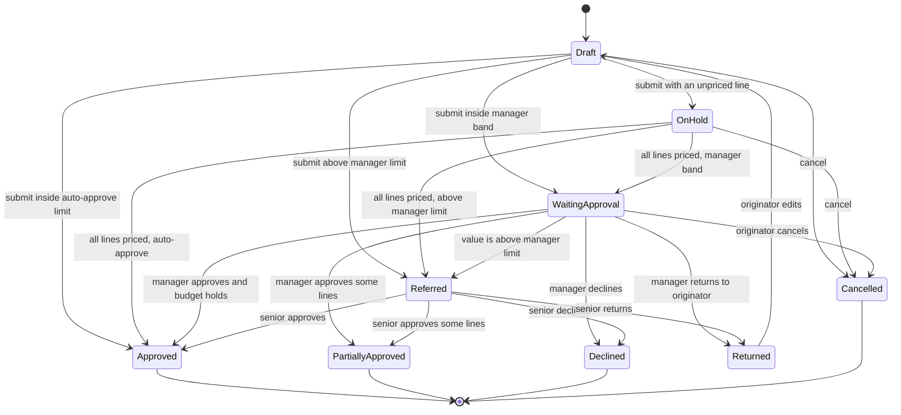
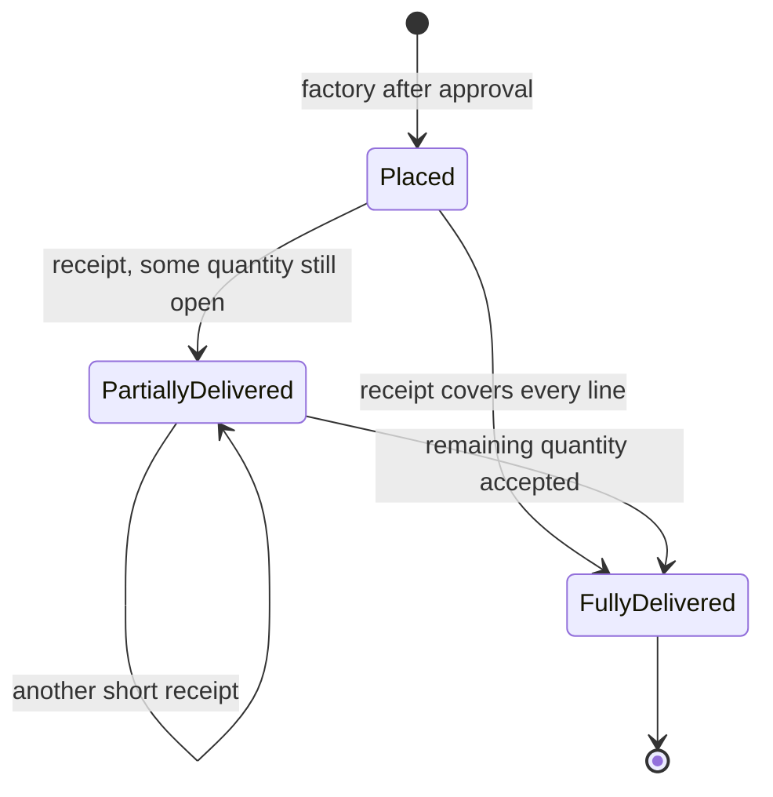
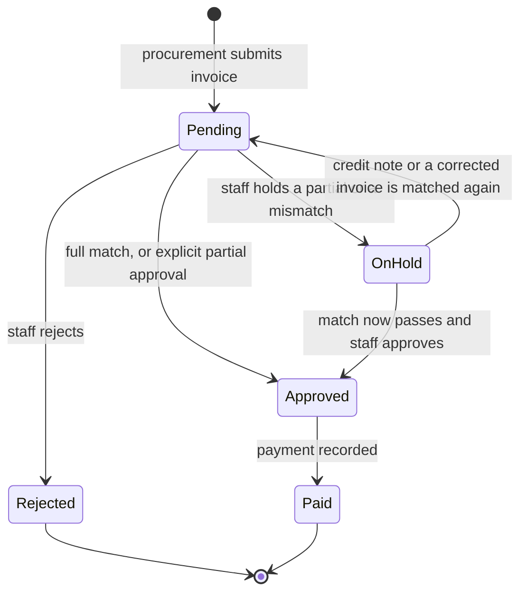

# State model

This diagram is new. ESAD-06 has no state machine. It is the diagram to include in the critical reflection for the “totally new diagram” mark. The implementation rejects any transition that is not drawn here.

## Requisition

Approved and Partially approved both run `PurchaseOrderFactory` for the approved lines. Returned goes back through Draft so the same submit rules run again.

## Purchase order

Over-receipt is refused. Damaged quantity does not move the state. A placed order can be invoiced only after at least one accepted unit, and payment locks the order only after a payment is recorded.

## Invoice

`Invoice.releasePayment` is legal only from Approved. On hold and Rejected throw.
