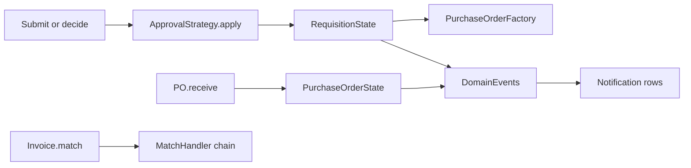

# Planning: five design patterns in the domain

This is the plan for putting Strategy, State, Factory, Observer, and Chain of Responsibility into the procurement domain. The requisition, purchase-order, and invoice behaviour stays the behaviour already specified in [design/05-state-model.md](../design/05-state-model.md) and locked in by [packages/domain/test/domain.test.ts](../packages/domain/test/domain.test.ts).

Public entry points stay `RequisitionWorkflow`, `PurchaseOrder.receive`, `PurchaseOrderFactory.split`, and `Invoice.performThreeWayMatch`. What changes is which object makes each decision.

## Where each pattern comes from

| Pattern | Place in the design |
| --- | --- |
| Strategy | The approval engine and the Rs. 10,000 / Rs. 100,000 thresholds |
| State | Requisition and purchase-order status transitions |
| Factory | Purchase-order creation, one PO per supplier |
| Observer | Notices such as “PO ready for invoice” and a returned requisition |
| Chain of Responsibility | The three-way match in the invoicing sequence |

## What was already in the code

- **Strategy** classified a total, then something else applied the result. `AutoApproveStrategy`, `ManagerApprovalStrategy`, and `SeniorReferralStrategy` read `ApprovalPolicy` (defaults Rs. 10,000 and Rs. 100,000). `routePriced` switched on `strategy.outcome` and set the status itself.
- **State** was a transition table plus direct writes in `PurchaseOrder.updateFulfillmentStatus`. Illegal moves were rejected, but there was no state object.
- **Factory** was already the right pattern. `PurchaseOrderFactory.split` groups approved lines by `supplierId` and builds one `PurchaseOrder` per group. `createOrdersFor` in the database service is the only caller. That class stays. The grouping does not move into the service.
- **Observer** did not exist. A return and a fully delivered purchase order only changed status. Notices are something the other role sees on the next load. There is no email or SMS.
- **Chain of Responsibility** did not exist. `Invoice.performThreeWayMatch` was one if/else: nothing accepted, full match, partial delivery, otherwise price mismatch.

## Strategy

`ApprovalStrategy` gains `apply(requisition)`:

- `AutoApproveStrategy` marks every line approved and moves the requisition to `APPROVED`.
- `ManagerApprovalStrategy` moves it to `WAITING_APPROVAL`.
- `SeniorReferralStrategy` moves it to `REFERRED`.

`routePriced` keeps the unpriced check. An unpriced line is not a money band: the requisition goes on hold and procurement sets the price. When every line is priced, `routePriced` calls `selectApprovalStrategy(...).apply(requisition)` and stops switching on the outcome.

Thresholds stay on `ApprovalPolicy`. Settings can change the bands without editing the strategy classes.

## State

Replace the allowed-transition map with one requisition state class per status under `packages/domain/src/state/`. Each class exposes only the actions that status allows:

`submit`, `cancel`, `approve`, `partialApprove`, `decline`, `returnToOriginator`, `refer`, `edit`, `resolveHold`.

Any other call throws the same kind of `DomainError` the workflow already throws. `RequisitionWorkflow` becomes a thin facade: load the state for `requisition.status`, delegate, and let that state write the next status. Budget checks, comments, and line approval flags stay in the states that already perform them (`WaitingApproval`, `Referred`).

Purchase orders get three states:

- `PlacedState` accepts a receipt and becomes `PARTIALLY_DELIVERED` or `FULLY_DELIVERED`.
- `PartiallyDeliveredState` accepts another receipt the same way.
- `FullyDeliveredState` refuses another receipt.

`PurchaseOrder.receive` keeps the quantity, damage-photo, and payment-lock checks, then asks the current state to move. The stored value remains the existing `PurchaseOrderStatus` string, so this pattern does not change the Prisma purchase-order columns.

The legal transitions are the ones already drawn for the walkthrough:

- A draft can be held, sent for approval, referred, auto-approved, or cancelled.
- On hold can be released into the same priced routes, or cancelled.
- Waiting for approval can be approved, partially approved, declined, returned, referred, or cancelled.
- Referred can be approved, partially approved, declined, or returned, and only by senior management.
- Returned goes back to draft when the originator edits it.
- Approved, partially approved, declined, and cancelled are terminal.
- A placed order becomes partially or fully delivered. A partial order can take another receipt. A fully delivered order cannot.

Damaged quantity does not move the purchase order. Over-receipt is refused.

## Factory

No structural rewrite. `PurchaseOrderFactory.split` remains the only place that groups lines by supplier and constructs `PurchaseOrder` objects in `PLACED`. Services continue to allocate `PO-2026-####` ids and persist the result. Items from two suppliers are never mixed on one purchase order.

## Observer

Add a small bus in `packages/domain/src/observer/`:

- `DomainEvent` covers `REQUISITION_RETURNED` (requisition id, originator id, comment) and `PO_READY_FOR_INVOICE` (purchase-order id).
- `DomainObserver.update(event)` and `domainEvents.publish`.
- `returnToOriginator` publishes the return event after the state move.
- The purchase-order state publishes ready-for-invoice only when the status becomes `FULLY_DELIVERED`.

A Prisma `Notification` row (`id`, `userId` nullable, `role` nullable, `kind`, `message`, `entityId`, `createdAt`) is written by one observer inside `packages/db/src/services.ts`, inside the same transaction as the status change. Returned requisitions are addressed to the site manager who created them. Ready-to-invoice notices are addressed to `PROCUREMENT_STAFF`.

Surface them on the next load:

- The office dashboard lists procurement notices.
- The site-manager home lists that user’s returned-order notices.
- `GET /api/v1/notifications` sits beside the existing dashboard route.

## Chain of Responsibility

Move the four match outcomes out of `performThreeWayMatch` into handlers under `packages/domain/src/matching/`:

1. `NotDeliveredHandler` — accepted quantity is zero.
2. `FullMatchHandler` — accepted quantity covers the order and the invoice amount matches the order value.
3. `PartialDeliveryHandler` — the receipt is short and the amount matches the accepted or ordered value.
4. `PriceMismatchHandler` — the terminal handler for every remaining case.

Each handler either returns a `MatchResult` or passes the same context to the next handler. `Invoice.performThreeWayMatch` builds the chain and calls the first handler. Approve, credit notes, and payment rules stay on `Invoice`.

## Tests the plan must keep green

Extend the domain tests. Do not change the outcomes the existing tests expect.

- Strategy: a small, middle, and senior total still land on `APPROVED`, `WAITING_APPROVAL`, and `REFERRED`, and a changed policy still selects a different band.
- State: an illegal requisition move and a receipt on a fully delivered purchase order still throw.
- Observer: returning a requisition and completing a delivery each publish exactly one event.
- Chain: full match, partial, price mismatch, and not-delivered still return the same outcomes.

Run `npm test` after the refactor. The office and phone apps need a check that the notice list renders, and that submit, return, delivery, and invoice approval still succeed.

The as-built map of these classes is in [Design patterns](design-patterns.md).
